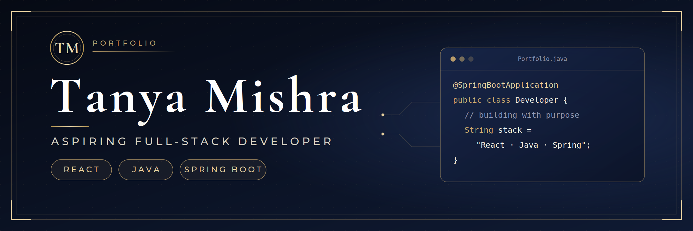

  

# Hi, I'm Tanya Mishra 👋

### Aspiring Full-Stack Developer | Frontend Development

I'm a Computer Science student learning web development by building practical projects and strengthening my programming skills.

- 💻 Learning frontend development
- 🎨 Exploring responsive web design
- 🌱 Practising Java and Data Structures & Algorithms
- 🚀 Building projects and improving my skills step by step

## 🛠️ Technologies & Tools

- **Frontend:** HTML, CSS, JavaScript
- **Currently Learning:** Bootstrap, React
- **Programming:** Java
- **Tools:** Git, GitHub, VS Code

## 🚀 My Projects

### 🌐 Personal Portfolio Website
A personal website showcasing my introduction, skills, and projects.

**Tech Stack:** HTML, CSS, JavaScript

### 🌍 Travel Sphere
A travel-planning website for exploring destinations and planning trips.

**Current Focus:** Improving website styling, UI, and functionality.

**Tech Stack:** HTML, CSS, JavaScript

**Status:** In Progress

### 🛒 E-commerce Website
An upcoming project to practise building an online shopping experience.

**Planned Start/Completion:** By December 2026

**Status:** Planned

## 🎯 My Goals

- Build responsive and user-friendly websites
- Improve my frontend development skills
- Learn full-stack development step by step
- Build projects that demonstrate my practical skills

## 🤝 Connect With Me

- GitHub: [@tanyamishrat044-hue](https://github.com/tanyamishrat044-hue)

---

⭐ Thanks for visiting my profile!
